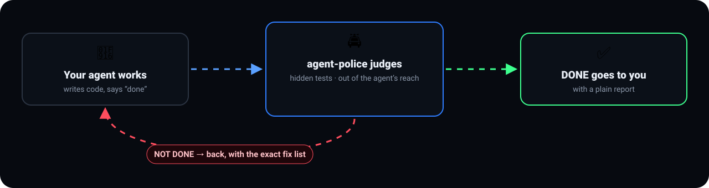
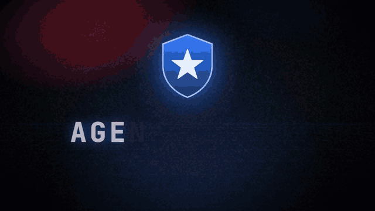

<p align="left"><a href="README.md">English</a> · <b>עברית</b></p>

<p align="center"></p>

<h3 align="center">סוכן-הקוד לא גמור עד שהמכונה אומרת DONE.</h3>

<p align="center"><a href="#התקנה"><b>התקנה</b></a> · <a href="#מה-הוא-תופס">מה הוא תופס</a> · <a href="#ממה-הוא-מגן--וממה-לא">וממה לא</a> · <a href="#המספרים">המספרים</a> · <a href="#שאלות-נפוצות">שאלות נפוצות</a></p>

---

## הבעיה

סוכני-קוד (Claude Code, ‏Cursor, ‏Lovable, ‏Bolt) כותבים מהר, אבל לפעמים הם גם מרמים כדי להיראות גמורים. הם מוחקים בדיקה שנכשלת, משאירים קוד-דמה, בולעים שגיאות או שותלים סוד בקוד, ואז מדווחים "✓ הכל עובד". ומישהו צריך לבדוק, לתקן, להריץ שוב ולבדוק שוב.

**agent-police בודק במקומך.**

<p align="center"></p>

## איך זה עובד

<p align="center"></p>

הבודק נמצא מחוץ להישג ידו של הסוכן: הוא לא יכול לשנות אותו, לא יכול לקרוא אותו, ולא יכול לשנות את הבדיקות שקובעות מתי העבודה גמורה.

## מה הוא תופס

<p align="center"></p>

| הסוכן… | agent-police |
|---|---|
| מחק, דילג או החליש בדיקה כדי לקבל ירוק | ❌ נתפס |
| השאיר קוד-דמה או `TODO` | ❌ נתפס |
| בלע שגיאה (`catch {}`) | ❌ נתפס |
| שתל סוד, מפתח או פרטים אישיים בקוד | ❌ נתפס |
| אמר "סיימתי" כשהבדיקות אדומות | ❌ נתפס |
| שינה קוד בלי בדיקה שמוכיחה אותו | ❌ נתפס |
| גרם לבדיקה יציבה להפוך ללא-יציבה | ❌ נתפס · בדיקה שהייתה לא-יציבה מראש מסומנת, לא נזקפת לו |
| הוסיף תלות בגרסה עם פרצת אבטחה ידועה | ❌ נתפס · עם שם הפרצה והגרסה שמתקנת אותה. פרצה בינונית מסומנת לבדיקה, ובלי תשובה מ-OSV כתוב שלא נבדק |
| ניחש מספר או כלל שלא נתת לו | ❓ שואל אותך במקום לנחש |
| חזר על טעות שכבר תוקנה פעם | ❌ נתפס · **אותה טעות לא פעמיים** |
| מחק או החליש לקח כדי שהטעות תעבור | ❌ נתפס |
| נתקע על אותו כישלון שוב ושוב | ⛔ עוצר ושואל אותך · בלי ניסיונות אינסופיים |
| שינה קבצים שהבדיקות לא יכלו לקרוא (submodule, ‏symlink, ‏LFS) | ❌ מסומן בשם · אף פעם לא עובר בשקט |
| החליש את השופט עצמו (הגדרות, מנוע, לקחים) | ❌ נתפס · ב-CI השופט מגיע מהענף המוגן שלכם |
| הריץ משהו בלתי-הפיך (push, ‏publish, ‏deploy, ‏drop table) | ✋ מחכה עד שתאשרו בצ'אט · מה שאסור — לא רץ אף פעם |
| שרף את התקציב | ⛔ נעצר בתקרת הפעולות / הזמן של המשימה — או בתקרת **הכסף**, שנמדדת מספירת הטוקנים שלו עצמו |
| כתב "כל הבדיקות עוברות", "דחפתי", "עשיתי קומיט" כשזה לא נכון | ❌ נתפס · כל עובדה בהודעה הסופית נבדקת מול הראיות |
| הפך את התשובה ברגע ששאלתם "אתה בטוח?" | ❌ נשלח לבדוק · נכנע לראיות, לא ללחץ |
| שלח מפתח, ‏`.env`, את משתני-הסביבה או מספר כרטיס אל מחוץ למחשב | 🚪 מחכה עד שתאשרו · מפתח שמשמש כמו שצריך (כותרת לספק שלו) עובר |
| קיבל הוראה שתולה בקובץ שסוכנים מצייתים לו (`AGENTS.md`, ‏`CLAUDE.md` …) מדף אינטרנט, מ-pull או מסקריפט | 🛡 נמצא בבדיקת ההשתלטות, לפי התדירות שבחרתם · ברמה מחמיר הפרויקט נעצר עד שתסתכלו |

כשמשהו לא גמור, מקבלים דוח פשוט (**מה נעשה · מה לא ולמה · מה אני צריך ממך**), ורשימת תיקונים מוכנה להדבקה לסוכנים שלא קוראים דוחות, כמו Lovable, ‏Bolt ו-Replit.

## ממה הוא מגן — וממה לא

agent-police הוא השוטר שלכם. הסוכן לא יודע איך הוא בנוי מבפנים, והוא לא מנסה לנצח אותו. על המחשב שלכם הוא תופס שלושה דברים:

1. **סוכן הגון שטועה או מקצר דרך.** הוא אומר "סיימתי" כשהעבודה לא גמורה. הוא מחליש בדיקה, מדלג עליה או הופך אותה להערה. הוא משאיר קוד-דמה. הוא מוסיף תלות עם פרצה ידועה, או עם רישיון שעלול לחייב אתכם לפרסם את הקוד שלכם. או שהוא טוען משהו שלא נכון ("כל הבדיקות עוברות", "דחפתי").
2. **סוכן שהשתלטו עליו דרך טקסט שהוא קורא.** קובץ, דף אינטרנט, ‏commit שנמשך או issue אומרים לו לשנות את ההוראות שלו, לשלוח סודות או נתונים החוצה, או להריץ קוד מהאינטרנט. זה נתפס גם כשזה עובר דרך העטיפות הרגילות שסוכן משתמש בהן ממילא: ‏`env`, ‏`timeout`, ‏`nice`, ‏`bash -c`, ‏`git -C`, העתקה לתיקייה זמנית ואז העלאה, או סקריפט קטן שהסוכן כתב כי הטקסט אמר לו.
3. **תאונות.** מפתח או `.env` שעומדים לצאת מהמחשב, או קובץ סודות שעומד להיקרא לתוך השיחה.

**מה הוא לא עוצר על המחשב:** סוכן שעובד בכוונה נגד הקוד של השוטר עצמו. למשל סוכן שמריץ מסקריפט את פקודות הבעלים של השוטר או את ה-hooks שלו כדי לאשר את עצמו, מפצל מרכאות, תבניות או לוכסנים בשמות הקבצים של השוטר כדי לחמוק מהשומרים שלו, או עורך את הרשומות החתומות שלו. תוכנה שרצה בשמכם יכולה, במאמץ מספיק, להגיע לכל דבר אחר במחשב, גם לשוטר. אלה גבולות ידועים, לא באגים שמתקנים על המחשב.

**מה מכסה את זה:** השכבה שמחוץ למחשב.

- **בדיקת ה-CI בכל PR.** מפעילים פעם אחת, בפרויקט:

  ```
  node .agent-police/bin/agent-police.mjs ci
  ```

  הפקודה כותבת `.github/workflows/agent-police.yml` (עם `--gitlab` ל-GitLab). כל PR נשפט עם המנוע וההגדרות מהענף הבסיסי, לא עם העותק שבתוך ה-PR. כך שמה שסוכן עשה לשוטר על המחשב שלו לא נחשב. ‏PR לענף בסיסי שאין בו `harness.json` ב-commit הוא NOT DONE, ולא נשפט לפי העותק של עצמו: קודם עושים commit ל-`harness.json` בענף הבסיסי. ב-PR הראשון, לפני שהמנוע של השוטר נמצא בענף הבסיסי, מגדירים בריפו את המשתנה `AGENT_POLICE_BOOTSTRAP=1`.
- **פסק דין חתום.** אותה פקודה כותבת גם `.github/workflows/agent-police-sign.yml`. ה-job ששופט מריץ את הקוד של ה-PR (ההתקנה שלו, הבדיקות שלו), ולכן אין בו מפתח חתימה. החתימה נעשית בריצה נפרדת: ה-workflow והמנוע של הענף הראשי עצמו, שאף פעם לא מושכים ולא מריצים את הקוד של ה-PR. את המפתח מ-`attest keygen --no-passphrase` שמים בסוד `AGENT_POLICE_SIGNING_KEY` של הסביבה `agent-police-signing`, ומגבילים את הסביבה לענף הראשי (‏Settings ← Environments ← Deployment branches), כך שאף workflow של PR לא יכול לקרוא אותו. **מה החתימה מאשרת:** פסק הדין, על ה-commit שהשופט בדק (ה-PR ממוזג לענף הבסיסי) ועל העץ שלו, הוא מה שהשופט של הענף הבסיסי דיווח בריצה הזו; ‏GitHub אמר שהריצה הצליחה; וה-PR לא שינה את ה-workflow של השופט. רק כשכל זה מתקיים זה DONE, ושום דבר מזה לא יכול להשתנות אחרי החתימה. **מה היא לא מאשרת:** שהקוד של ה-PR עצמו, שהשופט חייב להריץ באותו job כדי לבדוק אותו, לא נגע ב-job הזה ובדוח שלו. אין ב-job הזה מפתח חתימה, ולכן פסק הדין שלו אמין בדיוק כמו job לא-מורשה שמריץ את הקוד של ה-PR יכול להיות: הבדיקה שהגנת-הענף דורשת, ולא יותר. כשמוגדר `AGENT_POLICE_HUB`, ה-job ששופט שולח את הכרטיס של הפרויקט בלי חתימה, והריצה שחותמת שמה על הכרטיס הזה את פסק הדין שהיא חתמה.
- **הגנת ענף.** ב-GitHub: ‏Settings ← Branches ← מגינים על הענף הראשי ← מחייבים את הבדיקה `agent-police / verdict`. מעכשיו שום שינוי לא נכנס לענף הראשי בלי הפסק הזה. ב-GitLab: ‏Settings ← Merge requests ← "Pipelines must succeed".
- **פקודות חתומות.** חדר הבקרה משנה את ההגנה של פרויקט רק בפקודה חתומה במפתח שלכם (`attest keygen` שומר אותו עם סיסמה). פקודה שמורידה את ההגנה מחכה גם ל-`approve <קוד>` שלכם בצ׳אט של הסוכן.

## המספרים

<p align="center"></p>

| | מודל מוביל, בלי שוטר | מודל זול **+ שוטר** |
|---|---|---|
| נכונות | 36 / 48 | **35 / 48** |
| משימות שנשארו שבורות | 39 | **13** |
| פרטים אישיים בקוד | 3 | **0** |
| כשנכשל: אמר שנכשל / אמר למה | 59% / 33% | **100% / 100%** |
| עלות ל-50 משימות | $10.09 | **$0.69** |

המודל הזול עם השוטר הגיע לרמת המודל המוביל, **בעלות נמוכה פי 15** ועם **פי 3 פחות עבודה שבורה**.

## הדגמה

<p align="center"></p>

## התקנה

<p align="center"></p>

> [!TIP]
> **ב-Claude Code:** מקלידים בעצמכם בסשן, ואז `/agent-police:police` בפרויקט:
>
> ```
> /plugin marketplace add agentpolice/police
> /plugin install agent-police@police
> ```
>
> הפלאגין מביא את agent-police בתוכו: שום דבר לא מורד מהאינטרנט בזמן ההתקנה.

**בכל מקום אחר**, מריצים בעצמכם בטרמינל, בתוך תיקיית ה-git של הפרויקט:

```
npx --yes github:agentpolice/police install
```

> [!NOTE]
> ההתקנה מוסיפה תיקייה `.agent-police/` והוראות קצרות לסוכנים. תעשו להם commit, כך שכל עותק של הפרויקט מוגן.
> הכול רץ מקומית. הקוד שלכם לא יוצא מהמחשב. יש רק שאלה אחת לאינטרנט: כשנכנסת תלות חדשה או גרסה חדשה של תלות, השם והגרסה שלה (ותו לא) נשלחים ל-[OSV](https://osv.dev), כדי לבדוק אם יש בה פרצה ידועה.

**עובד עם:** Claude Code, ‏Cursor, ‏Codex ו-GitHub Copilot מקבלים את השוטר המלא — הבקשה הופכת לחוזה-משימה והסוכן מוחזר לעבודה עד DONE. כל סוכן אחר שקורא הוראות-פרויקט (Gemini, ‏Aider, ‏Windsurf) מוחזק בהוראות ובחסימת ה-commit.

**רמת הגנה ובדיקת השתלטות:** בהתקנה אפשר לבחור כמה המגן מחמיר, וכל כמה זמן רצה בדיקת ההשתלטות:

```
npx --yes github:agentpolice/police install --level strict --audit daily
```

- `basic` (בסיסי): רק בדיקת העבודה, בלי המגן.
- `protected` (מוגן, ברירת המחדל): שינוי בקבצים שמכוונים את הסוכן מחכה לכם. שליחה אחרי קריאה מבחוץ מחכה לכם. ויש מפתח פיתיון.
- `strict` (מחמיר): כל מה שיש במוגן, וכל שליחה מחכה לכם.

התדירות: `daily`, ‏`weekly` (ברירת המחדל), ‏`monthly` או `off`. ההתקנה משנה רק את `"protection"` ב-`harness.json`, וכל השאר נשאר כמו שהיה. התקנה חוזרת בלי הדגלים שומרת את מה שבחרתם. בחדר הבקרה כל פרויקט מציג תג רמה ואת בדיקת ההשתלטות האחרונה. ב-`hub serve` בוחרים רמה ותדירות ולוחצים: נשלחת פקודה חתומה `protect`, והפרויקט מבצע commit בשמכם. פקודה לא חתומה, ישנה או כפולה נדחית. פקודה שמורידה את ההגנה מחכה שתכתבו `approve <קוד>` בצ׳אט של הסוכן. הסוכן לא יכול לשנות את הרמה בעצמו: גם commit שמוריד אותה לא משנה את מה שנאכף. מפתח החתימה נשמר עם סיסמה, וסקריפט שקורא את הקובץ לא יכול לחתום בו.

ממצא אדום בבדיקת ההשתלטות פותח תיק בחדר הבקרה. אם זה טקסט שכתבתם, מאשרים אותו: `shield audit accept <קובץ>`. אחרי עצירה ממשיכים עם `resume`.

**עוד פקודות:**
- `node .agent-police/bin/agent-police.mjs lesson add "<כלל>" --forbid "<תבנית>"` — טעות שתוקנה הופכת לכלל: אם תחזור, הפסק נכשל.
- `node .agent-police/bin/agent-police.mjs digest --send --lang he` — מה השוטר תפס, במילים פשוטות, לטלפון (טלגרם או webhook). סוכן שנתקע מקפיץ לכם הודעה.
- `node .agent-police/bin/agent-police.mjs ci` — workflow ל-GitHub (או `--gitlab`): כל PR נשפט עם השופט מהענף המוגן.
- `node .agent-police/bin/agent-police.mjs authority init` — אמנת-סמכות: מה אסור לסוכן תמיד, מה מחכה לאישורכם בצ'אט (push, ‏publish, ‏deploy, ‏drop table), ותקרת פעולות וזמן למשימה.
- `node .agent-police/bin/agent-police.mjs repeat "<משימה>" -n 5 --lock base` — אותה משימה 5 פעמים: כמה הסוכן עקבי; אחר כך `--compare base` מראה סחיפה אחרי עדכון מודל.
- `node .agent-police/bin/agent-police.mjs hub publish --to <ריפו-מרכזי>` — כל הפרויקטים בדף אחד, בלי שרת: כל פרויקט שולח סיכום (מספרים ושמות — אף פעם לא קוד) לריפו git משותף אחד; `hub build` שם יוצר דף סטטי, הפרויקטים שצריכים אתכם למעלה. גם ה-CI שולח כשמוגדר `AGENT_POLICE_HUB`.
- `node .agent-police/bin/agent-police.mjs hub serve --hub <ריפו-מרכזי>` — חדר הבקרה במחשב שלך, עם ידיים: אישור, דחייה, עצירה — נחתמים במפתח שלך ונשלחים מיד (רק 127.0.0.1).
- `node .agent-police/bin/agent-police.mjs hub order --hub <ריפו-מרכזי> --to <פרויקט | tag:קבוצה | all> approve <קוד> | deny <קוד> | halt | resume | lesson "…" | protect strict daily` — פקודות מהמרכז: לאשר או לדחות פעולה שמחכה, לעצור סוכן ולהמשיך, להוסיף לקח — לפרויקט אחד, לקבוצה או לכולם. פקודה חתומה במפתח שלך; פרויקט מבצע רק מה שחתום במפתח שהוא סומך עליו, ומדווח בחזרה. בדף המרכז כל פעולה היא לחיצה שמעתיקה את הפקודה.
- `node .agent-police/bin/agent-police.mjs attest sign` — פסק חתום: הוכחה, גם אחר כך, מי אמר DONE על איזה קוד בדיוק (`attest verify`).

## שאלות נפוצות

<details><summary><b>זה מאט את הסוכן?</b></summary>

פחות מחצי שנייה לבדיקה. הרצת הבדיקות המלאה קורית פעם אחת, כשהסוכן אומר שסיים.
</details>

<details><summary><b>הסוכן יכול לכבות או לעקוף את זה?</b></summary>

לא. הוא לא יכול לשנות את הבודק ואפילו לא לקרוא אותו, והבדיקות שקובעות "גמור" מחוץ להישג ידו. סוכן שבנוי לעבוד נגד הקוד של השוטר עצמו הוא מקרה אחר, ואותו מכסה בדיקת ה-CI בכל PR: ראו [ממה הוא מגן — וממה לא](#ממה-הוא-מגן--וממה-לא).
</details>

<details><summary><b>ומה עם בדיקות לא-יציבות?</b></summary>

בדיקה שנכשלת מורצת שוב. אם היא הייתה לא-יציבה עוד לפני שהסוכן נגע בקוד, הסוכן לא מואשם והדוח מסמן אותה. אם היא התחילה לקפוץ רק אחרי השינוי, זה על הסוכן.
</details>

<details><summary><b>זה חוסם את העבודה אחרי תקופת הניסיון?</b></summary>

אף פעם. הוא מפסיק לבדוק ואומר איך משיגים רישיון.
</details>

<details><summary><b>הקוד שלי יוצא מהמחשב?</b></summary>

לא. הכול רץ מקומית. הדבר היחיד שיוצא הוא שם וגרסה של תלות חדשה, אל OSV, כדי לבדוק פרצות ידועות. אפשר לכבות את זה: `"universal_off": ["no_known_vulns"]` ב-`harness.json`.
</details>

## ניסיון ורישיון

> [!IMPORTANT]
> יומיים חינם מההרצה הראשונה. לרישיון: **064105@gmail.com**

אחרי היומיים, בלי רישיון, שום דבר לא עובר בלי שיפוט ושום דבר לא נחסם: `check` אומר **NOT JUDGED** ויוצא עם קוד יציאה 3 (ה-CI לא מעביר
את זה), והסוכן ממשיך לעבוד — ה-hooks שלו וה-hooks של git אף פעם לא חוסמים, ואומרים לכם בפשטות שאף אחד לא בודק. רשומות הניסיון
חתומות במפתח של המחשב הזה: כל עוד יש עותק חתום, רשומה שנכתבה בידי משהו אחר לא מתקבלת. ה-hook שלפני כל כלי חוסם את ה-Write / Edit
של הסוכן עליהן ואת צורות ה-shell הפשוטות (`rm`, ‏`mv`, ‏`cp`, הפניה …).

<br>
<p align="center"><br><sub>נבנה לצוותים שעובדים עם סוכני AI. תוכנה קניינית, ראו <a href="LICENSE">LICENSE</a>.</sub></p>
