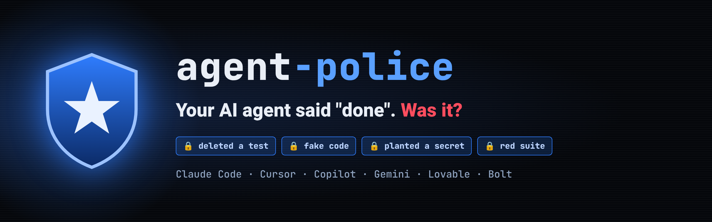

<p align="center"></p>

<p align="center"><b>The AI coding agent is not done until the machine says DONE.</b><br>
Claude Code · Cursor · GitHub Copilot · Gemini · Lovable · Bolt · Replit</p>

<p align="center"></p>

---

## The problem

Coding agents are fast. They also say *"✓ all tests pass, ready to ship"* when they aren't. They delete the failing test,
leave a stub, swallow the error, or paste a secret into the code. Then someone has to check, fix, re-run and check again.

**agent-police checks so you don't have to.** It sits next to the agent and doesn't let it say "done" until the work is real.

## What it catches

| The agent… | agent-police |
|---|---|
| deleted, skipped or weakened a test to get green | ❌ caught |
| left a stub, a `TODO`, or "not implemented" | ❌ caught |
| swallowed an error (`catch {}`) | ❌ caught |
| planted a secret, a key or personal data in the code | ❌ caught |
| said "done" while the test suite is red | ❌ caught |
| guessed a number or a rule you never gave it | ❓ asks you instead |
| changed code with no test that proves it | ❌ caught |
| made a stable test flaky | ❌ caught (an already-flaky test is flagged, not blamed) |

When something isn't done, you get a plain report: **done · not done and why · what I need from you**, plus a
ready-to-paste fix list for agents that can't read reports (Lovable, Bolt, Replit).

## The numbers

A 50-task benchmark, the same tickets with and without agent-police:

| | Top model, no police | Low-cost model **+ police** |
|---|---|---|
| Correct | 36 / 48 | **35 / 48** |
| Tasks left with a failing suite | 39 | **13** |
| Personal data left in code | 3 | **0** |
| On a failure: said so, and why | 59% / 33% | **100% / 100%** |
| Cost | $10.09 | **$0.69** |

The cheap model with the police matched the top model, at **1/15 of the cost**, with **3× less broken work**.

## Install

**Claude Code**, one step:

```
/plugin install agent-police --marketplace agentpolice/police
```

then type `/agent-police:police` in your project.

**Anywhere else**, inside your project's git folder:

```
npx --yes github:agentpolice/police install
```

The install adds a `.agent-police/` folder and short instructions for your agents. Commit them, so every clone is guarded.
It runs locally and offline. Nothing about your code leaves your machine.

## Use

| Command | What it does |
|---|---|
| `node .agent-police/bin/agent-police.mjs check` | the verdict on the current work: DONE / NOT DONE, and why |
| `node .agent-police/bin/agent-police.mjs prove` | judge finished work it never saw (a teammate's PR, a Lovable export): honest · gamed · failed |
| `node .agent-police/bin/agent-police.mjs handoff` | the plain-language report for you |
| `node .agent-police/bin/agent-police.mjs license` | trial / license status |
| `node .agent-police/bin/agent-police.mjs uninstall` | remove it |

## FAQ

**Does it slow the agent down?** Under half a second per check. The full test run happens once, when the agent says it's done.

**Does it block my work after the trial?** Never. It stops checking and tells you how to get a license.

**Can the agent turn it off?** No. It can't edit the checker or even read it, and the tests that decide "done" can't be changed by the agent.

## Trial and license

Two days free from the first run. For a license: **064105@gmail.com**

Proprietary software. See [LICENSE](LICENSE).
