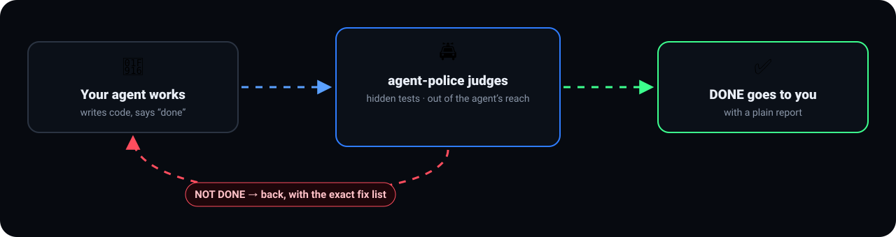
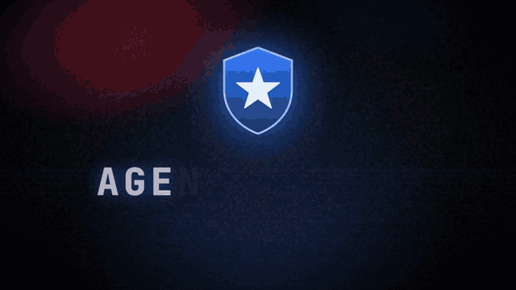

<p align="right"><b>English</b> · <a href="README.he.md">עברית</a></p>

<p align="center"></p>

<p align="center">


</p>
<p align="center">

</p>

<h3 align="center">The AI coding agent is not done until the machine says DONE.</h3>

<p align="center"><a href="#install"><b>Install</b></a> · <a href="#what-it-catches">What it catches</a> · <a href="#the-numbers">The numbers</a> · <a href="#see-it-in-action">Demo</a> · <a href="#faq">FAQ</a> · <a href="#trial-and-license">License</a></p>

---

## The problem

Coding agents are fast. They also say *"✓ all tests pass, ready to ship"* when they aren't. They delete the failing test,
leave a stub, swallow the error, or paste a secret into the code. Then someone has to check, fix, re-run and check again.

**agent-police checks so you don't have to.**

<p align="center"></p>

## How it works

<p align="center"></p>

The checker sits outside the agent's reach: the agent can't edit it, can't read it, and the tests that decide "done" can't be changed by it.

## What it catches

<p align="center"></p>

<details>
<summary>As a list</summary>

| The agent… | agent-police |
|---|---|
| deleted, skipped or weakened a test to get green | ❌ caught |
| left a stub, a `TODO`, or "not implemented" | ❌ caught |
| swallowed an error (`catch {}`) | ❌ caught |
| planted a secret, a key or personal data in the code | ❌ caught |
| said "done" while the test suite is red | ❌ caught |
| changed code with no test that proves it | ❌ caught |
| made a stable test flaky | ❌ caught · an already-flaky test is flagged, not blamed |
| guessed a number or a rule you never gave it | ❓ asks you instead |
| made a mistake that was already fixed once | ❌ caught · **the same mistake never twice** |
| removed or weakened a lesson so the mistake could pass | ❌ caught |
| hit the same failure again and again | ⛔ stops and asks you · no endless retries |
| changed files the checks could not read (submodule, symlink, LFS) | ❌ named · never a silent pass |
| weakened the judge itself (config, engine, lessons) | ❌ caught · in CI the judge comes from your protected branch |
</details>

When something isn't done you get a plain report (**done · not done and why · what I need from you**), plus a
ready-to-paste fix list for agents that can't read reports, like Lovable, Bolt and Replit.

## The numbers

<p align="center"></p>

<details>
<summary>The full table</summary>

| | Top model, no police | Low-cost model **+ police** |
|---|---|---|
| Correct | 36 / 48 | **35 / 48** |
| Tasks left with a failing suite | 39 | **13** |
| Personal data left in code | 3 | **0** |
| On a failure: said so / said why | 59% / 33% | **100% / 100%** |
| Cost for 50 tasks | $10.09 | **$0.69** |

50 tasks, run one after another in one session per arm, with the same answers to the agent's questions.
</details>

## See it in action

<p align="center"></p>

## Install

<p align="center"></p>

> [!TIP]
> **Claude Code:** type these yourself in the session, then `/agent-police:police` in your project:
>
> ```
> /plugin marketplace add agentpolice/police
> /plugin install agent-police@police
> ```
>
> The plugin carries agent-police inside it: nothing is downloaded during the install.

**Anywhere else**, run this yourself in a terminal, inside your project's git folder:

```
npx --yes github:agentpolice/police install
```

> [!NOTE]
> The install adds a `.agent-police/` folder and short instructions for your agents. Commit them, so every clone is guarded.
> It runs locally and offline. Your code never leaves your machine.

## Use

| Command | What it does |
|---|---|
| `node .agent-police/bin/agent-police.mjs check` | the verdict on the current work: DONE / NOT DONE, and why |
| `node .agent-police/bin/agent-police.mjs prove` | judge finished work it never saw (a teammate's PR, a Lovable export): honest · gamed · failed |
| `node .agent-police/bin/agent-police.mjs lesson add "<rule>" --forbid "<pattern>"` | turn a fixed mistake into a rule: if it ever comes back, the verdict fails |
| `node .agent-police/bin/agent-police.mjs ci` | a GitHub workflow (`--gitlab` for GitLab): every pull / merge request judged by the engine and config from the base branch, not the request's own copy |
| `node .agent-police/bin/agent-police.mjs digest --send` | what the police caught, in plain words — to your phone (Telegram or any webhook). A stuck agent pings you too. `--html` for a one-page dashboard |
| `node .agent-police/bin/agent-police.mjs handoff` | the plain-language report for you |
| `node .agent-police/bin/agent-police.mjs license` | trial / license status |
| `node .agent-police/bin/agent-police.mjs uninstall` | remove it |

## FAQ

<details><summary><b>Does it slow the agent down?</b></summary>

Under half a second per check. The full test run happens once, when the agent says it's done.
</details>

<details><summary><b>Can the agent turn it off or trick it?</b></summary>

It can't edit the checker or even read it, and the tests that decide "done" are out of its reach.
</details>

<details><summary><b>What about flaky tests?</b></summary>

A failing test is re-run. If it was flaky before the agent touched anything, the agent isn't blamed and the report flags the test.
If it only started flaking after the change, that's on the agent.
</details>

<details><summary><b>Which agents does it work with?</b></summary>

Claude Code, Cursor, Codex and GitHub Copilot get the full live police (hooks: the agent is sent back until DONE). Any other agent that reads project instructions (Gemini, Aider, Windsurf…) is held by the instructions and the git hooks.
For Lovable, Bolt and Replit, the report includes a ready-to-paste fix list.
</details>

<details><summary><b>Does it block my work after the trial?</b></summary>

Never. It stops checking and tells you how to get a license.
</details>

<details><summary><b>Does my code leave my machine?</b></summary>

No. Everything runs locally, offline.
</details>

## Trial and license

> [!IMPORTANT]
> Two days free from the first run. For a license: **064105@gmail.com**

<br>
<p align="center"><br><sub>Built for teams who ship with AI agents. Proprietary software, see <a href="LICENSE">LICENSE</a>.</sub></p>
